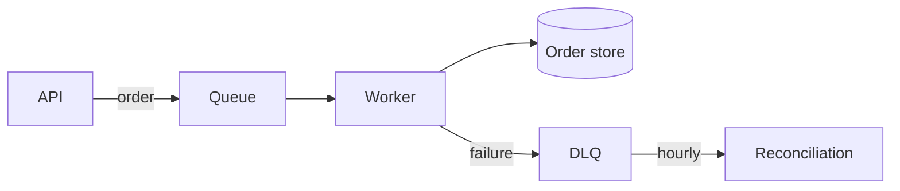

# Worked examples

Each example shows the original, the fix, and the general pattern behind it. Match the pattern, not
the wording.

The file paths and languages here are illustrative: one plausible repo, not a recommended layout.
Where an example says a fact belongs in a particular file, read it as "the place this repo keeps that
kind of thing". Find out what the repo in front of you actually does before proposing a move.

## 1. Marketing headings

**Before:** `## The one reviewed exception: Cloudflare Turnstile`

**After:** `## Exception: Cloudflare Turnstile`

The original borrows the shape of a headline written to compete for a click. "The one X" promises a
reveal. A reader scanning the table of contents wants to know what's in the section; everything past
that is spent attention.

**Pattern:** headings name their content. Cut anything doing persuasion.

## 2. Self-qualifying headings

**Before:** `### Why this matters for this project specifically`

**After:** `### Why`

"For this project specifically" is true of everything in the document, which is a project document. "Why
this matters" is what a "Why" heading means.

**Pattern:** delete words in a heading that are implied by where the heading is.

## 3. Reassurance welded to a fact

**Before:** "The worker is a separate ECS service, so isolating it is a displacement, not a rewrite."

**After:** "The worker is a separate ECS service. It can be moved later."

The fact is the first clause. The rest argues against an objection the reader hasn't raised, using
the manufactured-antithesis frame ("X, not Y") to do it. If the "can be moved" consequence matters,
state it plainly; if it doesn't, the first sentence stands alone.

**Pattern:** state the fact, stop. Reassurance is not information.

## 4. Sentences assuming unshared context

**Before:** "This also subsumes the old lambda reserved concurrency concern — a single worker with a
bounded DB pool caps RDS connections by construction."

**After:** "The worker holds a bounded DB pool, so RDS connections are capped by the pool size. This
replaces the old Lambda reserved-concurrency limit."

Two problems at once. It only parses if you already know what "the old concern" was, and it carries
two facts on an em dash. The fix establishes the mechanism first, then names what it replaces.

**Pattern:** the stranger test. Then split the run-on.

## 5. Defended decisions

**Before:** `## No savings plan — everything on demand, deliberately`

**After:** `## On-demand pricing`

Nobody documents an accident. "Deliberately" adds insistence, not information. The em dash is carrying a
second clause into a heading, where there's no room for one. If the reasoning matters, it
belongs in the section body, as the actual reason: "Usage is too variable to commit to a savings
plan."

**Pattern:** economy of words. Cut self-justification; if the reason is real, give the reason.

## 6. Comments restating code

**Before:**
```csharp
// Increment the retry counter
retryCount++;
```

**After:** Delete the comment.

**But:** if there's something non-obvious, that's what the comment is for:
```csharp
// Counts attempts, not retries. The first call increments too, so the cap is off by one
// from what the config name suggests.
retryCount++;
```

**Pattern:** inline comments carry why, not what. A comment restating the line is a maintenance
liability with no upside.

## 7. Leaky interface comments

**Before:**
```csharp
/// Order storage. Implemented by SqlOrderStore and InMemoryOrderStore.
/// The SQL version opens a transaction per call; the in-memory one is used in tests.
public interface IOrderStore
```

**After:**
```csharp
/// Persists and retrieves orders. Implementations must be safe to call from multiple
/// threads and must return null for a missing order rather than throwing.
public interface IOrderStore
```

The original documents the implementations, which is exactly what the interface exists to hide. It's
also the copy that goes stale the day someone adds a third implementation, and nothing will catch it.

**Pattern:** a contract describes what callers get and what implementers must provide. Naming
implementers is a leaked abstraction and a staleness trap.

## 8. Repeated facts

**Before:** The retry policy is described in `docs/architecture.md`, again in
`src/Worker/README.md`, and again in the doc comment on `RetryPolicy`.

**After:** The doc comment on `RetryPolicy` owns it: closest to the code, hardest to leave stale.
`src/Worker/README.md` links to the type. `docs/architecture.md` says that the worker retries and
links to the module README, because at architecture altitude the fact is "it retries", not the
backoff schedule.

**Pattern:** the change test. If the backoff changes, exactly one place should need editing.

## 9. Call chains as prose

**Before:** "The API publishes the order to the queue. The worker consumes from the queue and writes
to the order store. On failure it publishes to the dead-letter queue, which the reconciliation job
drains hourly."

**After:**


**Pattern:** nouns connected by verbs across multiple sentences is a diagram written as prose. The
reader has to build the picture themselves; give it to them.

## 10. Comments that should be renames

**Before:**
```csharp
// Checks whether the user is allowed to edit this document, taking
// ownership and the document's lock state into account.
public bool Check(User user, Document doc)
```

**After:**
```csharp
public bool CanEdit(User user, Document doc)
```

The comment exists because `Check` says nothing. Renaming carries the same information to every
reader at every call site, and can't drift from the code. Note that the "taking ownership and lock
state into account" half is describing the implementation. That's a leak, and it goes when the
method is named honestly.

**Pattern:** a comment restating what a method does is evidence the name is wrong. Propose the
rename, not a better comment.

## 11. Comments that should be types

**Before:**
```csharp
// status must be one of "pending", "settled", or "failed"
// timeoutMs is in milliseconds
public void Record(string status, int timeoutMs)
```

**After:**
```csharp
public void Record(SettlementStatus status, TimeSpan timeout)
```

Both comments were doing a type's job: unenforced, invisible at the call site, and stale the moment
a fourth status appears. The type is checked, shows up in autocomplete, and makes the wrong call
impossible rather than merely documented.

**Pattern:** a comment constraining a value is a type asking to exist. Same for "must not be null",
"call `Open()` first", and "pass either A or B, not both".

## 12. Duplicated value tables

**Before:** `AppOptions` defines `MaxConnections`. `docs/deployment.md` has a table of what each
environment sets it to. `docs/architecture.md` mentions the production value again as background.

**After:** `docs/deployment.md` links to the config files and states the rule instead of the numbers:

> Each environment sets `MaxConnections` to its RDS instance's connection limit, minus headroom for
> migrations. Current values: `config/`.

`docs/architecture.md` drops the number entirely. At architecture altitude the fact is "the worker
bounds its pool", and the specific value is a rung below. `AppOptions` keeps the option; that's the
definition.

Note what the rewrite gains beyond removing duplication: the rule tells a reader setting up a *new*
environment what to do. The table of three numbers never did.

**Pattern:** listing values that change. Text listing what a set of values currently is will go stale
silently. Link to the definition and state the rule that governs membership, not the membership.

## 13. Commit messages that should be docs

**Before:** A 40-line commit body explaining how the caching layer works, its invalidation rules, and
why Redis was chosen over in-process caching.

**After:** The invalidation rules and the Redis decision go to `src/Caching/README.md`, linked from
the architecture doc. The commit message becomes:

```
Add Redis-backed response caching

Cuts p99 on the catalogue endpoint from 800ms to 90ms under load test.
Design and invalidation rules: src/Caching/README.md
```

**Pattern:** durable knowledge in a commit message is only findable by someone already running
`git log` on the right file. Put it in the repo and leave a pointer.

## 14. Offhand phrasing kept as voice

**Before:** `## Scale to crush`, a section on horizontal scaling, written up from a design
discussion where someone said "then we can scale up resource to crush it".

**After:** `## Scaling`

The phrase came from speech, not from a decision about what to call anything. Written down it looks
like the author's voice, so the next editor protects it, and the one after that reads it as house
style. "Crush" adds confidence rather than information, and a reader who wasn't in that discussion
gets nothing from it, while the heading is simultaneously an index entry, a link target, and a
search term.

Compare a case that stays: `## Backfill`, for a section on populating the index for existing rows.
That is a named concept with a settled meaning, and using the name consistently is what makes it
useful.

**Pattern:** protect intent, not provenance. A metaphor doing explanatory work and a named concept
earn their place; a phrase that only exists because someone said it once does not.

## 15. Sentences that have to be read twice

**Before:** "Derivative sizes are generated up front, at ingest, from the single decode base
generation already holds."

**After:** "Derivative sizes are generated up front, at ingest, from the single decode that base
generation already holds."

Two defects stacked. `single decode base generation` is a four-noun stack, so the reader can't tell
where the noun phrase ends; and the relativizer is missing, so "already holds" arrives with nothing
to attach to. The reader parses the whole stack as the subject, hits the verb, and has to go back.

Restoring `that` is the one-word fix and it is worth doing on its own. The stronger rewrite splits
the stack as well: "...from the single decode that the base-generation step already holds."

**Pattern:** a misread costs more than the word that prevents it. This is the rare fix that adds
words, so say so in the report, or an author trained on "omit needless words" will push back.

## 16. A paragraph that is really a list

**Before:** "Its own worker task, a sibling of the pipeline worker, with the same
container/ECS-service shape, so it can be scaled independently and run to completion rather than
sitting in the ingest path. It reuses the NetVips core and the ensure-routine; it holds no image
logic of its own."

**After:**

> - Its own worker task, a sibling of the pipeline worker
> - Same container and ECS-service shape
> - Scaled independently
> - Runs to completion, outside the ingest path
> - Reuses the NetVips core and the ensure-routine
> - Holds no image logic of its own

Six parallel facts, packed into two sentences by commas and semicolons that are doing two jobs at
once. Nothing is cut and no wording is improved; the facts simply become countable, and each one
becomes something a returning reader can find without re-reading the paragraph around it.

**Pattern:** when a paragraph enumerates, let it enumerate visibly. The test is whether the items are
parallel and order-independent. Bulleting an argument destroys it; bulleting an inventory rescues it.
